## Summary
A web app (installable on PC, iPhone and Android) for building family trees of characters in books, made for Phill's step-daughter. Trees are vector-drawn so zoom stays sharp, with photos, dates, notes, groups/houses, custom links, search, spoiler protection, PNG/PDF/SVG export, colour themes with gradient backgrounds (per tree, plus a usual look that syncs across devices), photo cropping, snap-to-grid layout, adding both parents in one step, gender per character, an in-app "Suggest an improvement" form (arrives as GitHub issues), box selection to move whole branches, undo/redo, small markers on cards (gender, died, group), a refresh button that syncs and applies app updates, and offline use. Each tree syncs to the private GitHub repo phillbagnall/family-trees, so the same trees appear on every device. First version is live; next is setting up her devices and trying it with a real book.

## Next steps
- [ ] Create a fine-grained GitHub access key for phillbagnall/family-trees (Contents: read and write)
- [ ] Connect her PC and phone (paste the key, choose a PIN), and add the app to the phone's home screen
- [ ] Try a real book's tree and note what feels awkward
- [ ] Review suggestions she sends (issues labelled feedback in phillbagnall/family-trees)

## Key info
- App: https://phillbagnall.github.io/Family-Tree-Creator/ (GitHub Pages from main branch, no build step)
- Data: private repo phillbagnall/family-trees, files at trees/<id>/tree.json and trees/<id>/images/<id>.jpg
- Each device stores the access key encrypted with her PIN (never in the repo)
- PIN: change in Settings; "Forgot PIN?" on the lock screen reconnects with the access key; Settings → "Replace GitHub access key" when the key expires
- Shared settings (the usual look) live in settings.json in the trees repo; light/dark mode and the PIN stay per device
- Suggestions: app writes feedback/<id>.json to phillbagnall/family-trees; its Action (.github/workflows/feedback.yml) opens an issue labelled feedback and cc's you
- Local testing: `node dev/serve.mjs 8787` plus `node dev/mock-github.mjs 8788` (see README)
- When changing app files, bump VERSION in sw.js so installed copies update

## Notes

## Visuals
- 2026-11-23: Tree view (light theme) with groups, partners, divorce, spoiler pill
  - Build: first version — initial release
  - 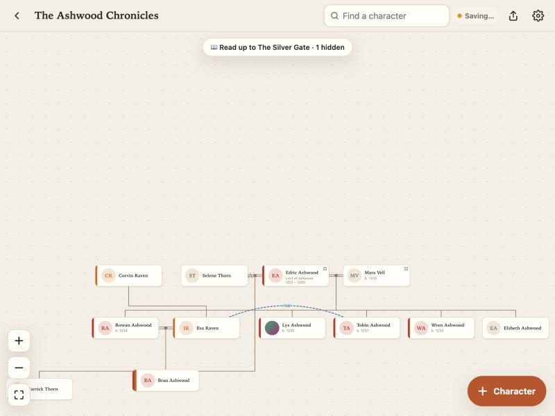
- 2026-11-23: Character editor on a phone
  - Build: first version — initial release
  - 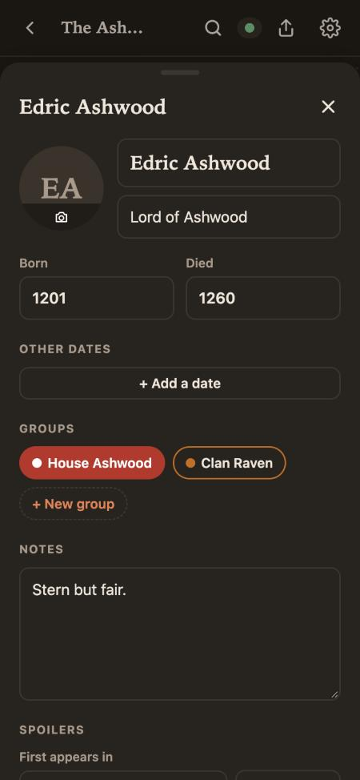
- 2026-11-23: Themes — blue default UI, button colour choices, gradient backgrounds from a chosen colour, per-tree look
  - Build: v2 (sw.js VERSION v2) — themes
  - 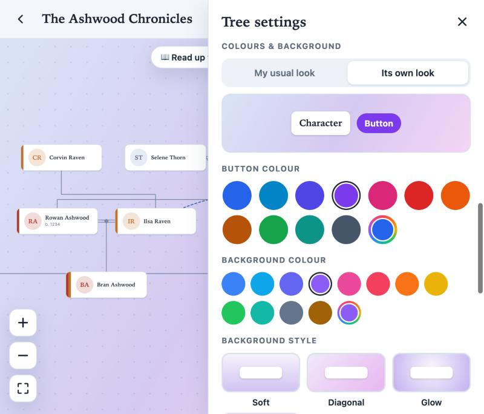
  - 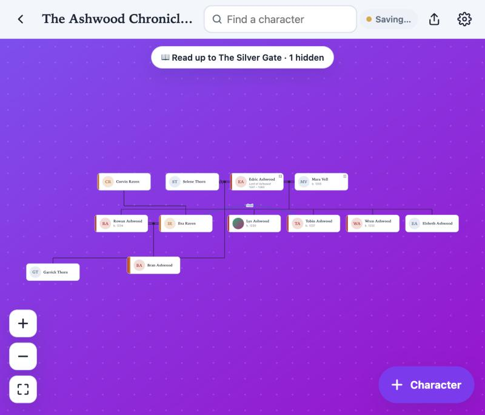
- 2026-11-23: Photo cropper — drag, pinch or slider to fit a picture in the circle
  - Build: v3 (sw.js VERSION v3) — photo cropping
  - 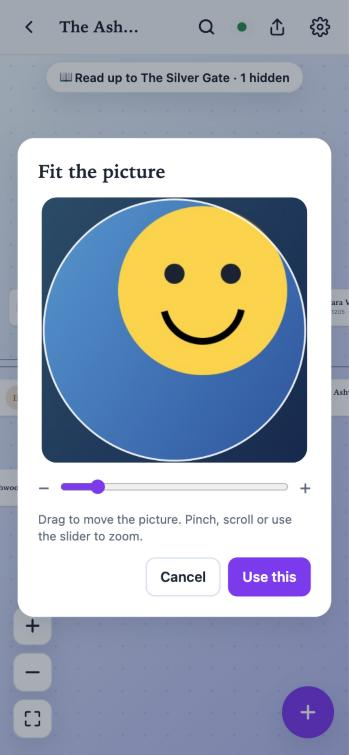
- 2026-11-24: Add both parents in one dialog (existing or new names); cards snap to a dot grid that moves with the tree
  - Build: v5 (sw.js VERSION v5) — snap to grid, add parents
  - 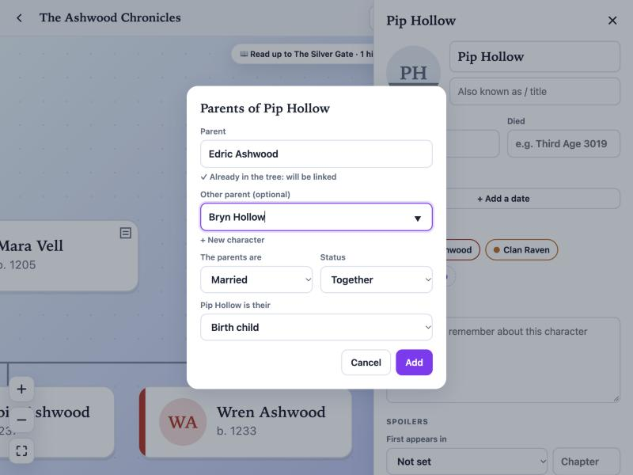
  - 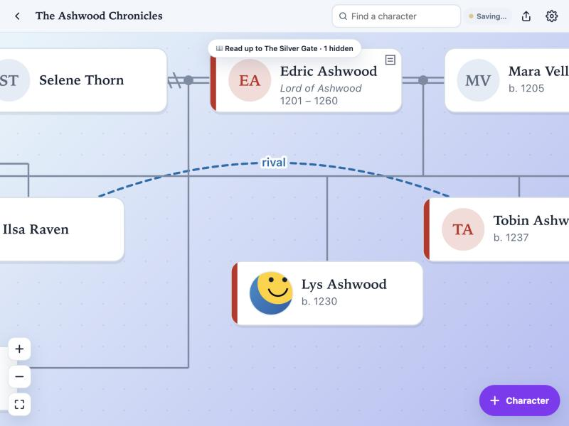
- 2026-11-24: Gender choice in the character panel (female, male, unknown, other with custom text)
  - Build: v6 (sw.js VERSION v6) — gender, suggestions
  - 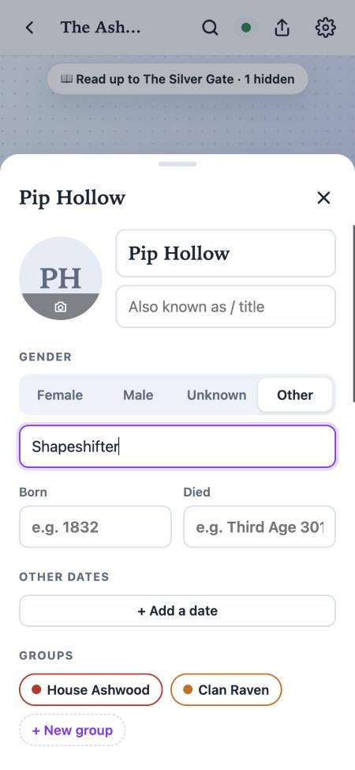
- 2026-11-24: Box select / "select this branch" to move a whole branch; refresh button (⟳) in the top bar
  - Build: v7 (sw.js VERSION v7) — refresh, box select
  - 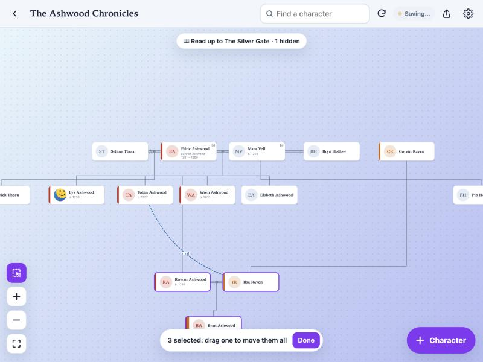
  - 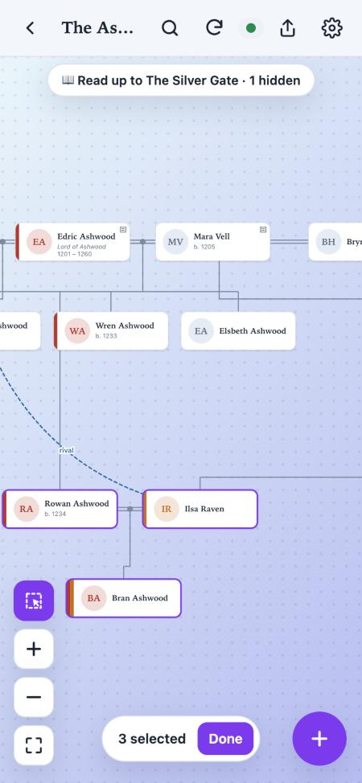
- 2026-11-24: Lines from different families kept at least two grid squares apart; names auto-capitalised
  - Build: v8 (sw.js VERSION v8) — line spacing, capitals
  - 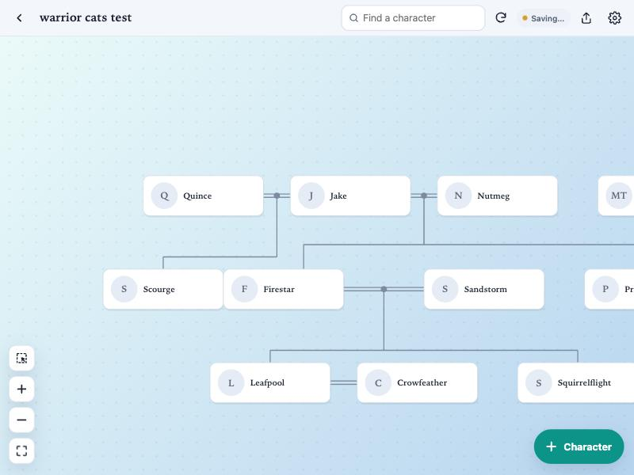
- 2026-11-24: Cards dropped onto other cards are nudged to the nearest free spot (one grid square clear, same row preferred)
  - Build: v9 (sw.js VERSION v9) — drop nudging
  - 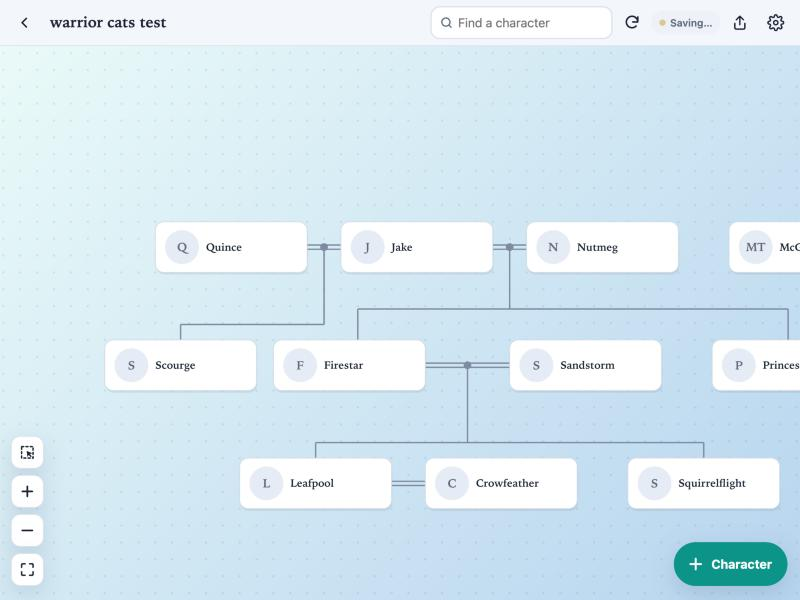
- 2026-11-24: Children sit exactly centred under their parents when they're within two grid squares of it
  - Build: v10 (sw.js VERSION v10) — centring
  - 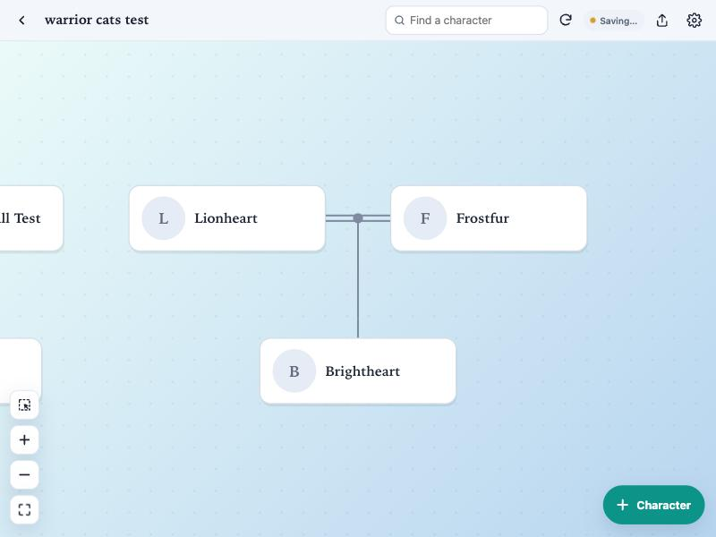
- 2026-11-24: Selection box now visible while dragging
  - Build: v12 (sw.js VERSION v12) — fix
  - 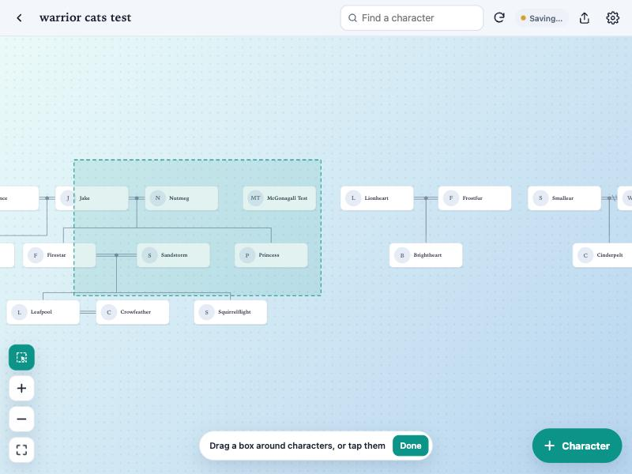
- 2026-11-24: Markers on a card (group letter, died, gender) and a new child placed under its hand-arranged parents
  - Build: v13 — undo, markers, placement
  - 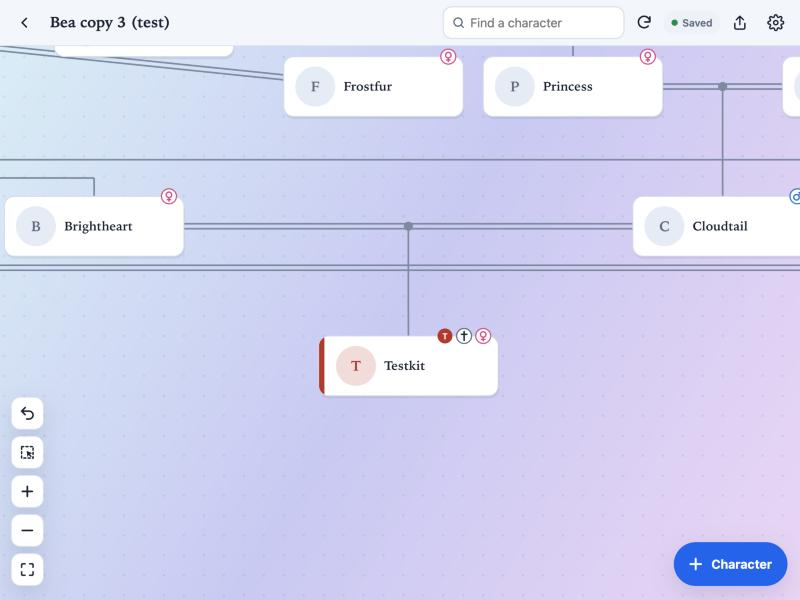
  - 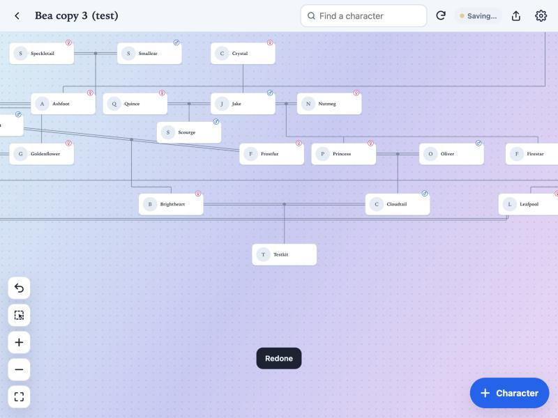

## Decisions
- 2026-11-23: Web app (PWA) rather than native apps, so one codebase covers PC, iPhone and Android with no app-store costs
- 2026-11-23: Sign-in is a repo-limited GitHub key entered once per device, protected by a PIN; no server to run
- 2026-11-23: Per-entity timestamps with merge on conflict, so edits on two devices (even offline) both survive
- 2026-11-23: App code repo is public (free GitHub Pages); tree data stays in a separate private repo
- 2026-11-23: Default UI changed from brown/orange to blue; themes are per tree (synced), the usual look is per device
- 2026-11-23: Usual look syncs via settings.json (newest edit wins); light/dark mode stays per device because it usually follows each device's own setting
- 2026-11-24: Grid is 24px; cards are 9x3 grid squares and the automatic layout also sits on the grid; snapping can be switched off per tree
- 2026-11-24: Suggestions travel as files in the data repo (her key already allows that) and an Action turns them into issues, so no extra key permissions or server are needed
- 2026-11-24: Refresh compares js/version.js with the running version and reloads only when there is an update (view and open tree are kept); the service worker now revalidates files so updates are never stale
- 2026-11-24: Existing names are capitalised by the app itself (once per tree, flag meta.namesCapitalised) rather than by editing her repo directly, so it merges safely with edits on her devices
- 2026-11-24: Centring is a final display step, not a change to the automatic spacing: changing the spacing would have shifted the 7 cards she has dragged out of line with the rest
- 2026-11-24: Couples have one Relationship choice (Married, Partners, Engaged, Married but separated, Divorced, Widowed, Were partners split up, Affair, Not known) instead of separate type + status, so contradictory mixes can't be picked; duplicate couples are merged when a tree opens
- 2026-11-24: Once a tree has any hand-placed cards, adding/linking/removing characters keeps every existing card exactly where it is (offsets are re-measured) and new characters are placed beside their family; untouched trees keep flowing automatically
- 2026-11-24: Undo steps are stored as before/after copies of just the changed entities and re-stamped when applied, so an undo wins over the change it undoes when syncing
- 2026-11-24: Layout v2 (couples who both have parents in the tree meet in the middle) applies to new trees and to a tree after Tidy up only, so her existing arrangement never shifts

## Log
- 2026-11-23: Added to the project dashboard
- 2026-11-23: Built and tested first version (layout, editor, sync with merge, photos, export, spoilers, offline)
- 2026-11-23: Added themes (button colours, gradient backgrounds, per-tree looks) and switched default UI to blue
- 2026-11-23: Added photo cropping (originals kept so photos can be re-cropped) and a replace-access-key option
- 2026-11-23: Usual look now syncs across devices
- 2026-11-24: Snap-to-grid (grid now pans/zooms with the tree) and add-both-parents dialog; partners of one person now stay grouped in the layout
- 2026-11-24: Added gender field and in-app suggestions that arrive as GitHub issues; tested end to end
- 2026-11-24: Added refresh button (sync + app update) and box selection / branch moving
- 2026-11-24: Auto-capitalised names (typing + one-off fix of existing names) and minimum spacing between family lines
- 2026-11-24: Dropped cards keep at least one grid square from other cards; checked her real Warrior Cats tree lays out with no cards closer than that
- 2026-11-24: Exact centring of children (and married-in partners) when nearly centred; verified on her real tree
- 2026-11-24: Single Relationship choice for couples; duplicate couples (Princess + Oliver x3 in her tree) merged automatically
- 2026-11-24: Fixed the selection box not showing while dragging (SVG elements ignore the .hidden property)
- 2026-11-24: v13: fixed pinch zoom drifting on iPhone (double zoom from Safari gesture events), undo/redo, new characters placed beside their family without moving others, couple lines routed under the row when cards are between them, selected character's lines highlighted, gender/died/group markers on cards, 'Has died' tick box
